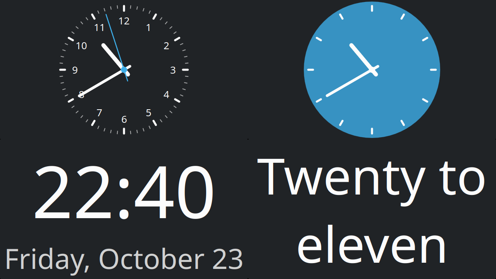

# MultiClock

A KDE Plasma desktop widget (Plasma 6, and Plasma 5.27 as a separate package) that shows the time as an analog clock, a digital readout, or fuzzy text ("quarter past ten"), switchable in settings.



## Features (v0.2)

- **Analog:** self-drawn (not the theme SVG). Show any combination of hour, minute and second hands, including a single hand on its own. 12- or 24-hour dial, configurable tick count, optional numerals.
- **Digital:** any Qt time format, optional date line.
- **Text:** nearest 5 minutes, nearest quarter hour, time of day, or your own phrases (see below).
- **General:** time zone (for when the system clock is not in your local zone), custom or theme foreground/accent colors, font, background on/off.
- **Transparent look:** turn off the widget background; the analog face can draw its own filled round dial in any color, including a translucent one.

## Custom phrases

In the Text settings choose **Custom**, pick a built-in set to start from, and edit it. One phrase per line, as `when = phrase`. The time is rounded to the "Round to" step first, then the first line that matches is used:

```
# rounded to 30 minutes
22:00-6:00 = Sleep
12:00 = Lunch
:00 = {Hour} sharp
:30 = Half past {hour}
```

- `12:00` is an exact time (24-hour clock), `:30` is that minute of any hour, `22:00-6:00` is a span (it may run past midnight).
- `{hour}` and `{next}` are this hour and the next as words; `{Hour}` and `{Next}` are capitalized; `{h12}`, `{h24}` and `{mm}` are digits.
- `hours = twelve, one, two, …` with 12 or 24 names replaces the hour words.
- Lines starting with `#` are notes. If no line matches, the time is shown as digits.

## Requirements

- KDE Plasma 6 (Qt 6), or Plasma 5.27 (Qt 5.15) for the Plasma 5 package
- `node` for `make check`
- a QML runner for `make preview`: `qml6` on Plasma 6 (`sudo apt install qml6` on Ubuntu), or `qmlscene` on Plasma 5 (`make preview QML=qmlscene`)
- `zip` for `make package`

## Usage

```sh
make test        # install, then open the widget in a plasmawindowed window (right-click to configure)
make check       # test the phrase logic
make preview     # all faces in a plain Qt window, no Plasma needed
make install     # install/update for your user, then add it via "Add Widgets…"
make restart     # restart plasmashell so the desktop picks up an updated install
make logs        # follow plasmashell logs; QML errors appear here
make package     # build dist/multiclock-<version>-plasma6.plasmoid and -plasma5.plasmoid
make uninstall
```

These targets are for Plasma 6. On Plasma 5.27 use `make install5`, `make test5` and `make uninstall5`.

From the KDE Store: right-click the desktop, *Add Widgets…*, *Get New Widgets…*, and search for MultiClock. The store page, with both packages: https://store.kde.org/p/2380181

To install a downloaded `.plasmoid` file (from the store or the GitHub releases): `kpackagetool6 -t Plasma/Applet -i multiclock-<version>-plasma6.plasmoid` (Plasma 6) or `kpackagetool5 -t Plasma/Applet -i multiclock-<version>-plasma5.plasmoid` (Plasma 5).

## Layout

Each package is assembled into `build/plasma6/` or `build/plasma5/` from its shell plus the shared files.

```
common/
├── ui/
│   ├── AnalogFace.qml            pure QtQuick faces (no Plasma imports)
│   ├── DigitalFace.qml
│   ├── TextFace.qml
│   ├── FuzzyTime.js              fuzzy-text phrase logic and rule format
│   └── ColorSetting.qml          theme-or-custom color picker for settings pages
└── config/
    └── main.xml                  settings schema (every setting lives here)
plasma6/                          Plasma 6 shell
├── metadata.json                 widget ID, name, license
└── contents/
    ├── config/config.qml         settings pages registry
    └── ui/
        ├── main.qml              root: time source, theme fallbacks, face switching
        └── config*.qml           settings pages
plasma5/                          Plasma 5.27 shell, same files
dev/
├── preview.qml                   standalone face preview
└── fuzzytime.test.js             phrase logic tests
```

## License

GPL-2.0-or-later, as declared in both `metadata.json` files. Add a `LICENSE` file with the full text before publishing; `reuse download GPL-2.0-or-later` or a copy from gnu.org will do.
